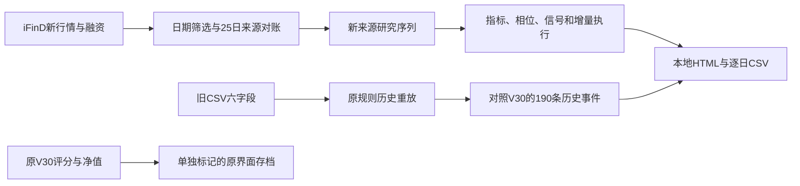

# A股顶底监测本地重建

直接打开 [index.html](index.html)。无需服务器、账号或联网，图表、四模块规则、日期选择、数据核验与CSV导出均可使用。

当前交付恢复了计算与展示骨架；原版连续评分映射尚未恢复，因此不是所有视觉输出的逐像素原版复制。原界面与评分另存 [original_v30_archive.html](original_v30_archive.html)，首屏明确标记存档，不作为新计算结果。

## 已找回的材料

- 原始附件HTML，2015-01-05至2026-08-25的结果包。
- 下载目录中的 `a_share_5_9_daily_reconstruction.csv`：3644日、2011-08-02至2026-08-04，六个原始数值字段及已算指标。三个同名副本SHA完全相同，只采用一份。
- 原 `wechat_cloud_auto_model_v2.zip` 中的模型函数、原Python信号核验脚本、指标重算及仓位脚本。原始文件原样归档在sources内。
- iFinD 2026-07至10月三条指数原始回执；沪深融资2022-02-23至2026-10-20完整1128日同源候选序列与季度回执。

## 输入、计算与输出



`model_core.cjs` 从找回的云函数提取计算函数，增加本地导出入口。没有调用云端入口、下载上传函数或微信SDK。不能运行sources/cloud_model_update.js作为部署命令；它仅作原始源码证据。

`prepare_data.py` 保留旧市场数据至8月4日，追加49个已与固定观察日序列对齐的候选交易日，截止10月20日。服务返回的非交易日沿用价格与空行全部隔离，未前填。

`build_model.cjs` 将两条研究线分开：

- 原版复现：只用旧3644日数据，重算190条历史正式事件，逐日期与原V30对照。
- 新来源研究：融资采用完整iFinD历史，不在63日增长或756日分位中把旧余额和新余额拼接。2022年之前没有新融资的区间保持缺失，不混用旧余额预热。该分支不是原历史190条事件序列，不能沿用旧准确率。

## 实际验证

- JS重放截至2026-08-04：Top5 63/63、Top9 34/34、Bottom5 56/56、Bottom9 37/37，无多余或缺失日期。
- 独立Python脚本读取旧主表的派生字段，再次对四模块信号日期核对，全部PASS；日志在checks/independent_python_verification.txt。它独立核验规则和日期，不独立认证原始行情真实性。
- 从原价格重建5%顶底各53个、9%顶底各25个，按原V30截止日过滤确认日，156个日期全部一致。输出同时保存极值日和确认日。
- 改变8月4日之后的价格及成交额，不改变8月4日及以前的研究事件。
- 由原净值反推55次仓位变化和8月4日0%冻结仓位，最大拟合误差约2.22e-16。此项不是从交易规则独立重算整个历史收益，不能拿它认证原回测表现。
- 桌面与390px手机浏览器检查通过，无JavaScript错误、无整页横向溢出；六个页签、七种图表字段与CSV导出通过。截图与核验JSON在outputs。

## 数据差异与未完成部分

1. 25日重叠期三条指数收盘完全一致。
2. 新成交额以万亿缩写返回，最大对账差约4824万元。保留显示精度问题，不称元级准确。
3. 旧2026-07-20换手率为0，iFinD为2.0269%；其他日期也有小差异，旧换手率分母/证券范围未充分确认。旧表原样保留，不静默改零值。
4. 新旧融资重叠期最大差1572.2859亿元。原因可能涉及供应商定义、市场范围或旧源问题，当前没有足够证据确定哪种；不得直接认定只差舍入。
5. V30评分与旧CSV评分版本不同。找回的模型函数能重算硬条件和事件，但未找到V30连续评分映射生成代码。重建页不生成替代分数；原评分仅供存档查看。
6. 当前使用的是收盘后研究规则，特征包括当日收盘；不是当天09:20盘前预测。历史公布时间、当时版本与官方交易日历仍未独立认证，新增事件不等于当年真实通知。
7. 数据没有更新至10月30日，而是统一截止已有完整融资候选的10月20日。未擅自填充后续交易日。

## 本地复算

需要Python 3和Node.js。主流程无第三方包依赖；独立旧Python核验需numpy与pandas。PowerShell在本目录运行：

```powershell
.\rebuild.ps1
```

主流程只读取本地sources，生成raw_history.json、outputs和两个HTML，不发送或发布。可选collect_indices.cjs用于重新取iFinD行情，依赖本机已配置的iFinD skill，默认不在复算流程中调用。

主要结果：

- outputs/recomputed_daily.csv：候选序列的逐日数据、指标与事件。
- outputs/legacy_signals.json：原数据190条信号所在的布尔序列。
- outputs/candidate_events.csv：新融资研究轨道全历史事件；不等于原通知。
- outputs/source_overlap.csv：全部150条原始字段重叠对账。
- outputs/reconstruction_audit.json：复现核验及未认证事项。
- outputs/input_manifest.json：所有本地源文件SHA256。
- outputs/candidate_execution.json：从旧冻结仓位开始接续的增量候选执行。

本轮交付均位于E盘；未修改D盘源文件或GitHub生产项目，未发布、未发送外部消息。
